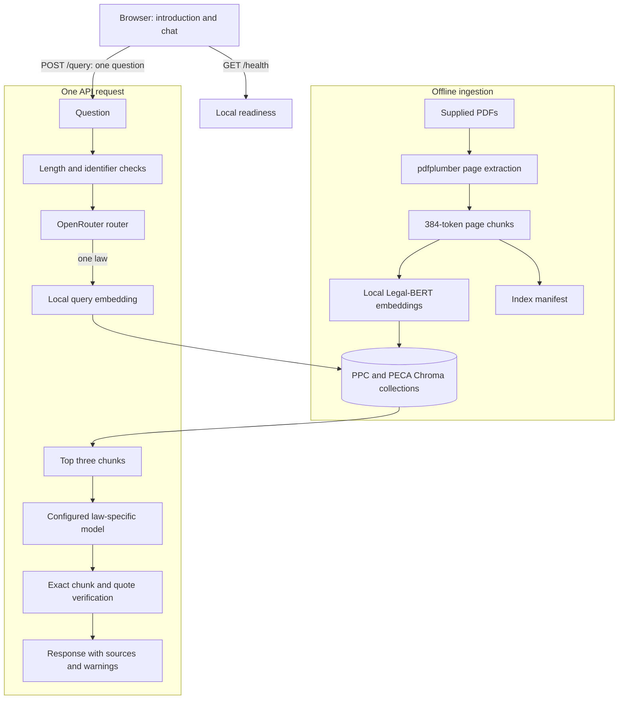

# PPC-PECA Lens architecture

## Purpose and boundaries

PPC-PECA Lens is a local-first reference application for two supplied English PDFs. It does not maintain server-side conversations, accept document uploads, make current-law claims, or provide legal advice.

## Main components



FastAPI also serves `/`, `/chat`, and `/ui/*` from the local `UI/` folder. The browser keeps visible turns only in page memory. Every question sent to `/query` stands alone. The graph is compiled without a LangGraph checkpointer or store, and its state exists only for one request.

## Offline ingestion flow

1. `src.ingestion_02.ingestion_01_loaders` reads PPC physical pages 22-178 and PECA physical pages 1-27. It normalizes layout whitespace but does not attempt to repair OCR wording.
2. `src.ingestion_02.ingestion_02_embedder` provides the `nlpaueb/legal-bert-base-uncased` tokenizer and normalized mean-pooled embeddings through Sentence Transformers.
3. `src.ingestion_02.ingestion_03_splitters` creates 384-token chunks with 48-token overlap. A chunk never crosses a physical page.
4. `src.utils_03.utils_02_vector_db` writes deterministic chunk IDs and source metadata to separate `ppc` and `peca` collections.
5. The manifest records source fingerprints, page ranges, embedding configuration, chunk configuration, and counts. Runtime refuses incompatible or changed sources until an explicit `--reindex`.

## Request flow

1. FastAPI and Pydantic reject missing, blank, oversized, or extra fields.
2. The input node rejects recognizable email, CNIC, and Pakistani mobile-number patterns and checks the 512-token encoder ceiling.
3. The configured router model returns strict JSON choosing `ppc`, `peca`, `both`, or `out_of_scope`.
4. A single-law route embeds the question locally and retrieves three chunks from its collection. Both-law questions ask for clarification; out-of-scope questions stop before retrieval.
5. The configured PPC or PECA model receives only the question and three excerpts. Source text is explicitly treated as untrusted data rather than instructions.
6. The output node accepts only known chunk IDs and quotations that occur in those chunks after whitespace normalization. Any missing or invalid evidence produces `insufficient_context`.
7. Every response includes the legal disclaimer. Answered and insufficient-context results also identify the relevant source quality limitation.

## Public interface

- `GET /` serves the introduction page, `GET /chat` serves the reference workspace, and `/ui/*` serves its CSS and JavaScript. These static routes are excluded from OpenAPI.
- `GET /health` checks environment names, manifest presence, and local collection counts. It never calls OpenRouter or loads the embedding model.
- `POST /query` accepts one standalone `question` and returns `status`, `law`, `answer`, `sources`, and `warnings`.
- Validation errors are sanitized so submitted content is not reflected in error responses.

## Security and privacy boundaries

- `.env`, local model/index artifacts, and evaluation outputs are excluded from Git.
- Questions and answers are not stored. The application creates no conversation database, cache, trace, or checkpoint.
- The browser uses no cookies, local storage, session storage, or analytics. Reloading or leaving the chat page discards its visible transcript.
- OpenRouter calls request zero-data-retention routing and deny data collection. If a configured model has no eligible endpoint, the API returns 503 rather than weakening the policy.
- Local source passages can contain hostile text. Generator prompts mark excerpts as untrusted, and no source text can select tools or alter graph control flow.
- The API binds to localhost in documented commands. It has no authentication, public CORS policy, or deployment hardening.

## Trade-offs and limitations

- Legal-BERT is required by the project but is a base BERT model rather than a retrieval-tuned sentence model. Mean pooling makes it usable for this prototype, while retrieval quality must be measured rather than assumed.
- Page-bounded chunking preserves understandable citations but may split a provision across adjacent pages.
- Dense top-three retrieval is simple and inexpensive but lacks keyword search and reranking.
- String-level citation checks prevent invented quotations, but they cannot determine whether reasoning is complete or legally sound.
- The supplied sources are dated or noisy. Replacing them with verified current official texts is required before any real legal use.

## Important paths

```text
src/domain_01/     Shared enums, exceptions, and internal models
src/ingestion_02/  Offline PDF extraction, token chunking, and embeddings
src/utils_03/      OpenRouter transport and Chroma persistence
src/core_04/       Routing, retrieval, generation, and guardrails
src/graph_05/      Stateless LangGraph state and nodes
src/api_06/        HTTP schemas, endpoints, and safe error mapping
UI/                Two same-origin pages, shared CSS, and in-memory chat behavior
evals/            Twenty-case evaluation dataset and runner
tests/            Offline unit and API/graph integration tests
```
