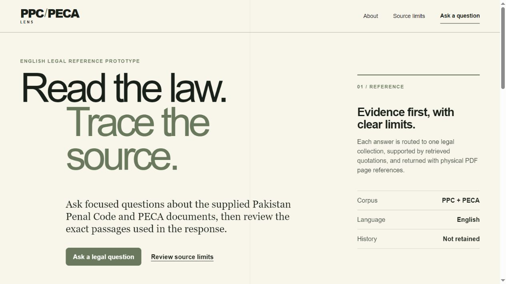
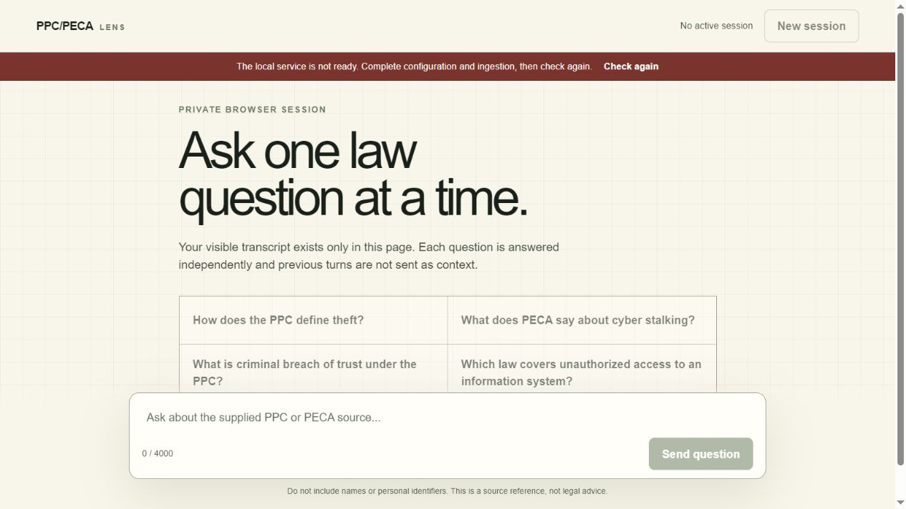
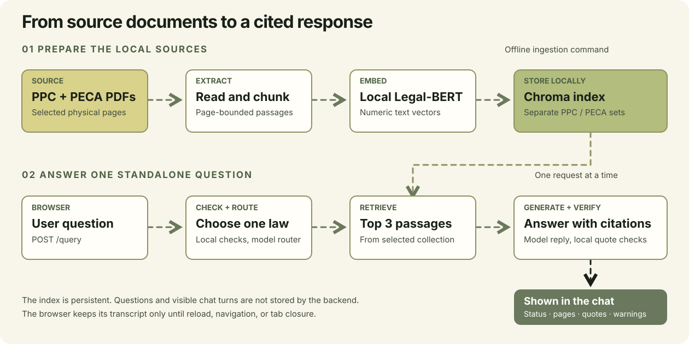

# PPC-PECA Lens

### Ask a question. Check the quotation. Find the page.

PPC-PECA Lens is a local, English-language reference app for the two supplied Pakistan Penal Code (PPC) and PECA PDFs. It combines a responsive browser interface with a FastAPI backend that retrieves source passages and checks quoted citations before showing an answer.

**[Quick start](#quick-start) · [Page previews](#page-previews) · [Animated data flow](#animated-data-flow) · [Architecture](ARCHITECTURE.md) · [Testing](#testing-and-evaluation)**

> [!WARNING]
> **Reference only, not legal advice.** The supplied PPC PDF says it was last amended on 16 February 2017. The PECA PDF is headed as a bill and contains visible OCR errors. These files cannot establish the current law; verify important points against current official sources.

## Page previews

The introduction explains the scope and source limits before a question is submitted.



The chat keeps visible turns only in the current browser page. This screenshot shows its **not ready** state before local indexing and model configuration; the composer enables after `/health` reports ready.



## Animated data flow

The left lane shows how the PDFs become a local search index. The right lane shows how one browser question becomes a sourced response. The moving arrows indicate direction; labels and arrows remain visible when animation is unavailable or reduced motion is preferred.



**[Open the full-size diagram](UI/data-flow.svg)** · **[Read the detailed architecture](ARCHITECTURE.md)** · **[See the numbered Python file order](src/FLOW.md)**

Only the PDF-derived index is persisted. The backend stores no questions, answers, conversation history, prompt cache, or LangGraph checkpoints. Each `/query` call handles one standalone question.

## What the app does

- Answers focused English questions from the selected PPC or PECA collection.
- Returns `status`, `law`, `answer`, `sources`, and `warnings`.
- Shows each cited filename, physical PDF page, chunk ID, and verified quotation.
- Requests clarification for a question spanning both laws and reports insufficient evidence rather than inventing citations.
- Rejects recognizable emails, Pakistani CNICs, and phone numbers locally before an external model call.
- Uses no browser cookies, local storage, session storage, analytics, or saved chat transcript.

## Quick start

You need **Python 3.12**, [`uv`](https://docs.astral.sh/uv/), the two PDFs already in `data/raw/`, and Internet access for dependency/model setup and OpenRouter requests. Run the following commands from the repository root in PowerShell.

**1. Install the locked environment.**

```powershell
uv sync --python 3.12 --dev
```

**2. Set the required model configuration.**

```powershell
Copy-Item .env.example .env
```

Fill in these values in `.env`:

```dotenv
OPENROUTER_API_KEY=your-key
ROUTER_MODEL_ID=provider/router-model
PPC_MODEL_ID=provider/ppc-generator
PECA_MODEL_ID=provider/peca-generator
```

The app has no model-ID defaults or automatic substitutions. Choose IDs available to your OpenRouter account. `.env` is ignored by Git; keep the key private. Optional paths and timeouts are listed in [.env.example](.env.example).

**3. Build the local search index.** The first run downloads `nlpaueb/legal-bert-base-uncased`, then indexes PPC physical pages **22–178** and PECA physical pages **1–27**.

```powershell
uv run python -m src.ingestion_02
```

Repeated ingestion uses deterministic chunk IDs. If a source or embedding configuration changes, rebuild deliberately with `uv run python -m src.ingestion_02 --reindex`. The index lives under `data/processed/`.

**4. Start the app on localhost.**

```powershell
uv run uvicorn src.api_06.api_02_main:app --host 127.0.0.1 --port 8000
```

Open the [introduction](http://127.0.0.1:8000/) or [chat](http://127.0.0.1:8000/chat). The chat checks `/health` before enabling the composer. Press **Enter** to send and **Shift+Enter** for a new line. **New session**, reload, navigation away, and tab closure discard visible turns.

In WSL, use `cp .env.example .env` for step 2; the remaining `uv` commands are the same.

## API usage

Readiness checking makes no paid model call:

```powershell
Invoke-RestMethod http://127.0.0.1:8000/health
```

The response reports `status`, `index_ready`, `configuration_ready`, and PPC/PECA collection counts. A `not_ready` result keeps the chat unavailable until configuration and ingestion are complete.

Ask one standalone question:

```powershell
$body = @{ question = "How does the PPC define theft?" } | ConvertTo-Json
Invoke-RestMethod -Method Post -Uri http://127.0.0.1:8000/query -ContentType application/json -Body $body
```

Query results use `answered`, `insufficient_context`, `needs_clarification`, or `out_of_scope` and include a legal disclaimer. An answered result provides cited source entries. HTTP failures use sanitized **422** validation, **502** unusable provider response, **503** unavailable service or eligible model endpoint, and **504** timeout errors.

## Testing and evaluation

The offline suite mocks OpenRouter, so it uses no API credit:

```powershell
uv run pytest
```

If Node.js is installed, check the frontend script with `node --check UI/app.js`. Plain HTML, CSS, and JavaScript need no browser build step.

After ingestion and model configuration, run the 20-case live evaluation:

```powershell
uv run python -m evals.run_evals
```

Live evaluation needs a funded API key. It reports routing and status accuracy, retrieval hit@3, citation validity, and latency. Grounding still needs human review: matching a quotation cannot prove that legal reasoning is complete or correct.

## Stack and boundaries

| Component | Role |
| --- | --- |
| HTML, CSS, JavaScript | Two responsive, same-origin pages in `UI/` |
| FastAPI and Pydantic | HTTP routes and input/output validation |
| `pdfplumber` | Extraction from selected physical PDF pages |
| Sentence Transformers and Legal-BERT | Local source and question embeddings |
| ChromaDB | Separate local PPC and PECA collections |
| LangGraph and LangChain messages | Stateless request workflow |
| `httpx` and OpenRouter | Async routing and generation requests |

OpenRouter calls request zero-data-retention routing and deny data collection. These are provider-policy controls, not an independently verified deletion guarantee. Basic identifier checks can miss names and other personal information. Citation checks prove only that a quotation appears in retrieved material; they cannot establish current law or legal correctness. The documented server binds to `127.0.0.1` and has no authentication or public-deployment controls.

For component details, see [ARCHITECTURE.md](ARCHITECTURE.md). The English-only prototype leaves current official sources, OCR repair, Urdu retrieval, reranking, a judge model, uploads, and public deployment for future work.

## License

No license has been selected. Ask the project owner before publishing the code under an open-source license.
